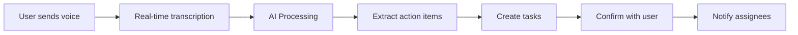

# MillionTasks v2.0 Product Specification
## The Future of Conversational Task Management

---

## Executive Summary

MillionTasks v2.0 represents a paradigm shift from "task management in messengers" to "your personal productivity AI that happens to live where you already communicate." This version transforms MillionTasks from a reactive task tracker into a proactive productivity partner that anticipates needs, learns patterns, and orchestrates team collaboration—all through natural conversation.

**Version 2.0 Core Theme**: *Intelligence First, Tasks Second*

---

## 1. Vision Statement

### The Problem We're Solving (v2.0)

While v1.0 successfully brought task management to messengers, users still face:
- **Cognitive overload** from manually tracking everything
- **Context switching** between voice, text, and visual information
- **Reactive management** - always playing catch-up with tasks
- **Collaboration friction** - coordinating across teams requires constant communication
- **Pattern blindness** - missing insights about their productivity habits

### Our Solution: The Ambient Productivity Layer

MillionTasks v2.0 becomes an **ambient intelligence layer** that:
- **Listens** to voice messages and extracts action items automatically
- **Sees** screenshots and documents to understand visual context
- **Predicts** what you need before you ask
- **Orchestrates** team coordination seamlessly
- **Learns** your patterns and adapts to your working style

### The "Wow" Moment

Imagine sending a 2-minute voice message to your team about a project update. MillionTasks automatically:
1. Transcribes and summarizes the key points
2. Extracts 5 action items with assignees
3. Creates tasks with smart due dates
4. Notifies relevant team members
5. Schedules a follow-up reminder
6. Updates the project dashboard

All without you typing a single command.

---

## 2. Feature Prioritization Matrix

| Feature | User Value | Dev Effort | Innovation | Priority |
|---------|------------|------------|------------|----------|
| **Voice Intelligence** | 10/10 | 6/10 | 9/10 | **P0 - Critical** |
| **Proactive AI Assistant** | 9/10 | 7/10 | 10/10 | **P0 - Critical** |
| **Team Sync** | 8/10 | 5/10 | 7/10 | **P0 - Critical** |
| **Smart Templates** | 7/10 | 4/10 | 6/10 | **P1 - High** |
| **Visual Task Management** | 8/10 | 6/10 | 8/10 | **P1 - High** |
| **Multi-Modal Input** | 7/10 | 8/10 | 9/10 | **P2 - Medium** |
| **AI Delegation** | 6/10 | 9/10 | 10/10 | **P2 - Medium** |

---

## 3. Detailed Feature Specifications

### 3.1 Voice Intelligence 🎙️
*"Talk naturally, we'll handle the rest"*

#### Overview
Transform voice messages into structured tasks, making MillionTasks the first task manager that truly understands spoken communication. Users can brain-dump ideas, meeting notes, or project updates via voice, and the AI extracts actionable items.

#### User Stories

**Story 1: The Commuter**
```
Sarah (driving): *sends 3-minute voice message*
"Just left the client meeting. We need to revise the proposal by Friday,
John should update the budget section, and Maria needs those mockups ready
for review by Wednesday. Oh, and remind me to call the vendor tomorrow
about the contract renewal."

MillionTasks responds:
✅ Created 4 tasks from your voice message:
1. 📝 Revise client proposal → You (Due: Friday)
2. 💰 Update budget section → @John (Due: Friday)
3. 🎨 Prepare mockups for review → @Maria (Due: Wednesday)
4. 📞 Call vendor about contract renewal → You (Tomorrow 9 AM)

📊 Summary saved to "Client Meeting Notes - Oct 6"
Want me to notify John and Maria?
```

**Story 2: The Manager**
```
Mike: *forwards team voice message from WhatsApp to MillionTasks*
"Team update from the standup meeting attached"

MillionTasks:
🎯 Processed standup recording (5:23):

Extracted Tasks:
• Fix login bug → @Alex (mentioned at 1:23)
• Deploy to staging → @Sam (mentioned at 3:45)
• Update documentation → @Pat (mentioned at 4:50)

⚠️ Blocker detected: Database migration issue (2:30)
Would you like me to create a high-priority task for this?
```

#### Functional Requirements

1. **Voice Processing Pipeline**
   - Accept voice messages up to 10 minutes
   - Support multiple languages (start with English, Spanish, Mandarin)
   - Handle multiple speakers in single recording
   - Process forwarded voice messages from other apps

2. **Intelligence Layer**
   - Real-time transcription with speaker diarization
   - Intent extraction with confidence scoring
   - Entity recognition (dates, people, projects)
   - Sentiment analysis for priority detection
   - Action item extraction with assignee mapping

3. **Output Formats**
   - Structured task list with assignments
   - Meeting summary with key decisions
   - Follow-up questions for ambiguous items
   - Searchable transcript archive

#### User Experience Flow



#### Technical Considerations

- **Transcription Service**: Whisper API for accuracy
- **Processing**: Stream processing for real-time feedback
- **Storage**: Compressed audio storage with retention policies
- **Privacy**: On-device processing option for sensitive content
- **Fallback**: Manual transcript editing capability

#### Success Metrics

- Voice message → tasks conversion rate > 80%
- Accuracy of extracted action items > 90%
- Time saved per voice message: 5+ minutes
- User engagement with voice features > 60% weekly active

---

### 3.2 Proactive AI Assistant 🤖
*"Your AI that thinks ahead"*

#### Overview
Transform from reactive task tracking to proactive productivity management. The AI learns your patterns, anticipates needs, and takes initiative—like a real assistant would.

#### User Stories

**Story 1: The Pattern Learner**
```
Monday 8 AM - MillionTasks initiates:
"Good morning! Based on your patterns, Mondays are usually busy.
Here's what I've prepared:

📋 Your week ahead:
• 5 client deliverables (2 at risk)
• Team standup in 1 hour
• 3 follow-ups from last week pending

🤔 I noticed you always create a weekly report on Monday afternoons.
Should I draft one based on last week's completed tasks?

⚡ Quick actions:
[Start standup prep] [Review at-risk items] [Generate report]"
```

**Story 2: The Smart Reminder**
```
Context: User frequently forgets quarterly reviews

MillionTasks (proactive):
"Hey! Quarterly reviews are coming up in 2 weeks. Last quarter,
you started 3 days before deadline and mentioned it was stressful.

Want me to:
1. Create review tasks for each team member now?
2. Set up daily 30-min slots for review prep?
3. Pull performance data from our last conversations?

[Yes to all] [Customize] [Remind me later]"
```

#### Functional Requirements

1. **Pattern Recognition**
   - Analyze task creation patterns
   - Identify recurring workflows
   - Detect deadline patterns
   - Learn communication preferences

2. **Proactive Interventions**
   - Morning briefings with personalized insights
   - Risk detection for upcoming deadlines
   - Smart reminders based on context
   - Automated task creation for recurring items
   - Workload balancing suggestions

3. **Predictive Assistance**
   - Due date suggestions based on history
   - Priority recommendations
   - Assignee suggestions for team tasks
   - Template detection and automation

4. **Conversational AI Memory**
   - Remember preferences across conversations
   - Context carryover between sessions
   - Learn naming conventions
   - Understand implicit project associations

#### User Experience Flow

```yaml
Daily Proactive Cycle:
  Morning:
    - Daily briefing with priorities
    - Weather/traffic aware scheduling
    - Energy level optimization

  Midday:
    - Progress check-in
    - Deadline alerts
    - Meeting prep reminders

  Evening:
    - Day wrap-up summary
    - Tomorrow's preparation
    - Pending item alerts

  Weekly:
    - Pattern insights
    - Productivity analytics
    - Workflow optimization suggestions
```

#### Success Metrics

- Proactive intervention acceptance rate > 70%
- Task completion rate improvement > 25%
- Deadline miss rate reduction > 40%
- User-reported "surprise" tasks reduced by 50%

---

### 3.3 Team Sync 👥
*"Effortless team coordination"*

#### Overview
Revolutionary team coordination that eliminates status meetings and update emails. Teams stay synchronized automatically through ambient intelligence.

#### User Stories

**Story 1: The Distributed Team**
```
Team Channel - Monday 9 AM:
"🌅 Team Sync for Project Apollo

✅ Completed over weekend:
• API integration (John)
• Design mockups (Sarah)

🚀 Starting today:
• Frontend implementation (@Alex)
• Testing setup (@Sam)

⚠️ Blockers:
• AWS credentials needed for Sam
• Design feedback pending from client

📊 Project health: 78% on track (down from 85%)
[View details] [Start standup] [Address blockers]"
```

**Story 2: The Handoff**
```
Alex completes a task, MillionTasks automatically:

"✅ Alex completed 'Backend API endpoints'

🔄 Auto-handoff triggered:
→ Created 'Test API endpoints' for @QA-Team
→ Updated project progress: 45% → 52%
→ Notified @Sarah: "Frontend can now integrate"
→ Scheduled review with @TechLead for tomorrow

No action needed unless you want to modify."
```

#### Functional Requirements

1. **Ambient Awareness**
   - Monitor task completions across team
   - Detect dependencies automatically
   - Track blocker discussions
   - Aggregate progress in real-time

2. **Smart Orchestration**
   - Automatic task handoffs
   - Intelligent work distribution
   - Capacity-aware assignment
   - Cross-timezone optimization

3. **Communication Synthesis**
   - Daily team digests
   - Project health scores
   - Blocker escalation
   - Achievement celebrations

#### Success Metrics

- Reduction in status meetings > 60%
- Task handoff time < 5 minutes
- Team awareness score > 8/10
- Project delay reduction > 30%

---

### 3.4 Smart Templates 📋
*"Your workflows, automated"*

#### Overview
AI-detected patterns become reusable workflows. When the system recognizes you're starting a familiar process, it automatically scaffolds the entire workflow.

#### User Stories

**Story 1: The Product Launcher**
```
User: "Starting new feature launch for user analytics"

MillionTasks:
"I've detected this matches your 'Feature Launch' pattern.
Based on your last 3 launches, here's the complete workflow:

📦 Feature Launch: User Analytics (23 tasks)

Week 1: Planning
□ PRD draft → You
□ Tech spec → @Eng-Lead
□ Design brief → @Designer

Week 2: Development
□ Backend setup → @Backend-Team
□ Frontend scaffolding → @Frontend-Team
□ Test plan → @QA

Week 3: Testing & Polish
□ Integration testing → @QA
□ Performance testing → @DevOps
[... 15 more tasks]

Dates and assignees set based on your typical timeline.
[Create all] [Customize] [Start fresh]"
```

#### Functional Requirements

1. **Pattern Detection**
   - Identify recurring task sequences
   - Learn project types
   - Detect workflow triggers

2. **Template Intelligence**
   - Auto-generate templates from history
   - Smart parameter filling
   - Adaptive scheduling
   - Role-based assignment

3. **Library Management**
   - Personal template library
   - Team template sharing
   - Public template marketplace
   - Version control for templates

#### Success Metrics

- Template usage rate > 40% of projects
- Time saved per project > 2 hours
- Template accuracy (no modifications needed) > 70%

---

### 3.5 Visual Task Management 📸
*"Show don't type"*

#### Overview
Share screenshots, photos, or documents, and MillionTasks understands what needs to be done. Perfect for bug reports, design feedback, or visual planning.

#### User Stories

**Story 1: The Bug Reporter**
```
User: *sends screenshot of broken UI*
"This looks wrong"

MillionTasks:
"I can see a UI alignment issue in the navigation bar.
Creating bug report:

🐛 Bug: Navigation bar alignment issue
• Component: Header/Navigation
• Severity: Medium (visual only)
• Screenshot: Attached
• Detected issues:
  - Logo shifted 10px right
  - Menu items not centered
  - Mobile responsive break

Assign to: @Frontend-Team (they handled nav last)
[Create bug report] [Add more details] [Change assignee]"
```

**Story 2: The Whiteboard Capturer**
```
User: *sends photo of whiteboard from meeting*

MillionTasks:
"📸 Processed whiteboard from meeting:

Extracted Action Items:
1. Research competitor pricing → Marketing
2. Update Q4 roadmap → Product
3. Schedule customer interviews → UX Team
4. Review budget allocation → Finance

Key Decisions Captured:
• Launch date moved to Nov 15
• Budget approved for 2 new hires
• Feature X deprioritized

Should I create tasks for all action items?"
```

#### Functional Requirements

1. **Visual Processing**
   - OCR for text extraction
   - UI element detection
   - Diagram understanding
   - Handwriting recognition

2. **Context Integration**
   - Link visuals to tasks
   - Auto-generate descriptions
   - Smart categorization
   - Visual diff detection

3. **Supported Formats**
   - Screenshots (bugs, designs)
   - Photos (whiteboards, notes)
   - Documents (PDFs, specs)
   - Diagrams (flowcharts, wireframes)

#### Success Metrics

- Visual → task conversion success > 75%
- Bug report completeness > 85%
- Time saved per visual task > 10 minutes

---

## 4. Differentiation Analysis

### Why Users Will Switch from Existing Tools

| Current Tool | Pain Point | MillionTasks v2.0 Solution | Switching Trigger |
|--------------|------------|---------------------------|-------------------|
| **Todoist** | Requires manual input for everything | Voice intelligence creates tasks from natural conversation | "I can just talk to create tasks!" |
| **Notion** | Complex setup, high learning curve | Zero setup, learns your patterns automatically | "It just works out of the box" |
| **Asana** | Heavyweight, requires everyone to adopt | Lives in existing messenger, no new app needed | "My team doesn't need training" |
| **Things 3** | Beautiful but isolated | Integrated where work happens | "Tasks appear where I already am" |
| **Monday.com** | Expensive, over-engineered | Simple, AI-driven, affordable | "It does what I need without complexity" |

### Unique Capabilities Only Possible with AI + Messenger

1. **Ambient Task Capture**: Extract tasks from existing conversations without explicit commands
2. **Cross-Platform Intelligence**: Learn from Telegram, apply in Slack
3. **Natural Delegation**: Mention someone in voice, they get assigned automatically
4. **Context Preservation**: Tasks retain full conversational context
5. **Zero-UI Workflows**: Complete entire workflows without seeing an interface
6. **Social Proof**: See what teammates accomplish in real-time
7. **Voice-First Mobile**: Perfect for commutes, walking, hands-busy situations

---

## 5. Implementation Roadmap

### Phase 1: Foundation (Months 1-2)
**Goal**: Enhance AI capabilities and prepare infrastructure

- [ ] Upgrade AI architecture for GPT-4/Claude-3 integration
- [ ] Implement multi-modal message handling
- [ ] Create pattern recognition system
- [ ] Build template detection engine
- [ ] Set up voice processing pipeline

### Phase 2: Voice Intelligence (Months 2-3)
**Goal**: Launch the killer voice feature

- [ ] Integrate Whisper API
- [ ] Build action item extraction
- [ ] Create voice → task pipeline
- [ ] Add multi-language support
- [ ] Launch with Telegram first

### Phase 3: Proactive AI (Months 3-4)
**Goal**: Transform into proactive assistant

- [ ] Build pattern learning system
- [ ] Create proactive intervention engine
- [ ] Implement daily briefings
- [ ] Add predictive due dates
- [ ] Launch smart reminders

### Phase 4: Team Features (Months 4-5)
**Goal**: Revolutionize team coordination

- [ ] Build Team Sync engine
- [ ] Create automatic handoffs
- [ ] Implement team analytics
- [ ] Add project health monitoring
- [ ] Enable cross-team templates

### Phase 5: Visual Intelligence (Months 5-6)
**Goal**: Complete the multi-modal experience

- [ ] Integrate OCR/Vision APIs
- [ ] Build screenshot → bug report flow
- [ ] Add whiteboard processing
- [ ] Create visual task management
- [ ] Launch visual feedback loops

### Phase 6: Scale & Optimize (Month 6+)
**Goal**: Polish and expand

- [ ] Add Signal and Slack support
- [ ] Optimize AI costs
- [ ] Build template marketplace
- [ ] Create enterprise features
- [ ] Launch public API

---

## 6. Success Metrics & KPIs

### North Star Metrics
- **Daily Active Users (DAU)**: Target 100K by end of Year 2
- **Task Completion Rate**: Improve from 65% → 85%
- **Voice Usage**: >50% of tasks created via voice
- **Team Adoption**: Average team size from 1 → 5 members

### Feature-Specific KPIs

| Feature | Key Metric | Target | Timeline |
|---------|------------|--------|----------|
| Voice Intelligence | Voice → Task Conversion | 80% | Month 3 |
| Proactive AI | Suggestion Acceptance | 70% | Month 4 |
| Team Sync | Status Meeting Reduction | 60% | Month 5 |
| Smart Templates | Template Usage Rate | 40% | Month 4 |
| Visual Tasks | Screenshot Processing Success | 75% | Month 6 |

### User Satisfaction Indicators
- NPS Score > 70
- App Store Rating > 4.7
- Word-of-mouth referrals > 40%
- Churn rate < 5% monthly

---

## 7. Technical Considerations

### Architecture Enhancements

```yaml
New Services Required:
  voice_processor:
    - Whisper API integration
    - Real-time transcription
    - Speaker diarization

  pattern_engine:
    - ML pipeline for pattern detection
    - Time-series analysis
    - Clustering algorithms

  visual_processor:
    - GPT-4 Vision integration
    - OCR service
    - Image storage CDN

  proactive_scheduler:
    - Cron-based interventions
    - User timezone handling
    - Intelligent notification batching
```

### AI Cost Optimization
- Implement smart caching for common patterns
- Use smaller models for simple classifications
- Batch process non-urgent items
- Offer premium tier for unlimited AI features

### Privacy & Security
- End-to-end encryption for voice messages
- On-device processing option
- GDPR/CCPA compliant data handling
- Team data isolation

---

## 8. Risks & Mitigation

| Risk | Impact | Probability | Mitigation |
|------|--------|-------------|------------|
| AI costs exceed budget | High | Medium | Implement tiered pricing, optimize model usage |
| Voice accuracy issues | High | Low | Use best-in-class APIs, allow manual correction |
| User privacy concerns | High | Medium | Clear privacy policy, on-device option |
| Feature complexity overwhelm | Medium | Medium | Progressive disclosure, smart defaults |
| Messenger API changes | High | Low | Abstract platform layer, multiple messengers |

---

## 9. Competitive Moat

### Why MillionTasks v2.0 Will Win

1. **First-Mover Advantage**: First true voice-first task manager in messengers
2. **Network Effects**: Team features create viral growth loops
3. **Data Advantage**: Learning from millions of tasks improves AI
4. **Platform Lock-in**: Deep messenger integration creates switching costs
5. **AI Expertise**: Focused entirely on AI-driven experience

### Defensibility
- Proprietary pattern recognition algorithms
- Accumulated user behavior data
- Messenger relationship/partnerships
- Brand association with "AI task management"

---

## 10. Go-to-Market Strategy

### Launch Sequence

1. **Beta Program** (Month 2)
   - 100 power users
   - Weekly feedback sessions
   - Feature co-creation

2. **Voice Intelligence Launch** (Month 3)
   - Product Hunt launch
   - Tech influencer campaign
   - "Voice-first productivity" positioning

3. **Team Features Launch** (Month 5)
   - Target startups and small teams
   - Slack community partnerships
   - Team onboarding incentives

### Pricing Strategy

```yaml
Tiers:
  Free:
    - 100 tasks/month
    - Basic AI features
    - 1 project

  Pro ($9/month):
    - Unlimited tasks
    - All AI features
    - Unlimited projects
    - Voice intelligence

  Team ($29/month):
    - Everything in Pro
    - Team sync features
    - Shared templates
    - Analytics

  Enterprise (Custom):
    - Self-hosted option
    - Custom AI training
    - SLA support
    - Compliance features
```

---

## Conclusion

MillionTasks v2.0 represents a fundamental reimagining of task management. By combining the intimacy of messaging platforms with the intelligence of modern AI, we're creating something that doesn't just track tasks—it actively helps users be more productive.

The key insight: **People don't want another task manager. They want an intelligent assistant that happens to be great at managing tasks.**

With voice intelligence as our trojan horse and proactive AI as our moat, MillionTasks v2.0 will transform how millions of people work, one conversation at a time.

---

*"The best task manager is the one you don't have to manage."*

**Next Steps:**
1. Validate voice intelligence with 10 beta users
2. Build MVP of pattern recognition
3. Create investor pitch deck
4. Start technical architecture planning
5. Begin partnership discussions with Telegram/Slack